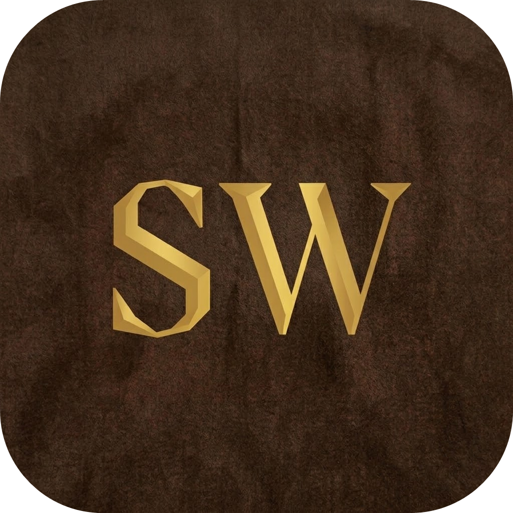

<p align="center">
  
</p>

<h1 align="left">SundaWiki</h1>

SundaWiki is an elegant and responsive cultural encyclopedia website dedicated to exploring, preserving, and sharing knowledge about Sundanese spirituality, core values, and indigenous heritage.

## 🌐 Live Demo

Experience the live application here:  
👉 **[SundaWiki](https://sundawiki.vercel.app/)**

## ✨ Key Features

- **Bilingual Support (ID / EN)**: Real-time dynamic language switching between Indonesian and English without reloading the page.
- **Cultural & Spiritual Philosophy**: Educational sections covering fundamental relationships with the Divine, Nature, and Fellow Human Beings.
- **5 Core Values**: In-depth presentation of core Sundanese virtues—*Cageur* (Healthy), *Bageur* (Virtuous), *Bener* (Righteous), *Pinter* (Wise), and *Singer* (Adaptive).
- **Baduy Heritage Spotlight**: Exploration of the Baduy (Urang Kanekes) community, their sacred relationship with nature, and their cultural connection with the wider Sundanese people.
- **Responsive & Ambient UI**: Warm cultural aesthetic with glassmorphism cards, gold accents, fluid grid layouts, and typography powered by *Playfair Display* and *Inter*.
- **Interactive Navigation & Animations**: Scroll-triggered fade-in reveals, responsive mobile navigation drawer, and smooth anchor scrolling.

## 🛠️ Tech Stack

- **HTML5**: Semantic document structure and accessible content organization.
- **CSS3**: Layouts built with CSS Grid and Flexbox, custom CSS variables, glassmorphism filters, keyframe animations, and media queries.
- **JavaScript (ES6+)**: Pure vanilla JavaScript for state handling, DOM manipulation, client-side language switching, and scroll interactions.
- **Font Awesome 6**: Vector icon set for UI elements.
- **Google Fonts**: Web typography using *Playfair Display* and *Inter*.
- **Hosting**: [Vercel](https://vercel.com)

## 💻 Local Setup Instructions

No build tools or external dependencies are required.

1. **Clone the repository**:
   ```bash
   git clone https://github.com/evanhendramulyadi/SundaWiki.git
   cd SundaWiki
   ```

2. **Run the application**:
   - Open `index.html` directly in any modern web browser, **or**
   - Serve it using a lightweight local development server:
     ```bash
     # Using Python
     python -m http.server 3000
     ```
     Then open `http://localhost:3000` in your browser.

## 📄 Copyright & Ownership

© 2026 Evan Hendra Mulyadi. All Rights Reserved.

This project is an original work created by **Evan Hendra Mulyadi**.

This repository is publicly accessible solely for viewing, studying, and reviewing the source code. Public access does **not** grant permission to copy the entire project, rebrand or rename it, remove attribution, or claim it as your own creation. Re-use or distribution without explicit permission from the author is strictly prohibited.

